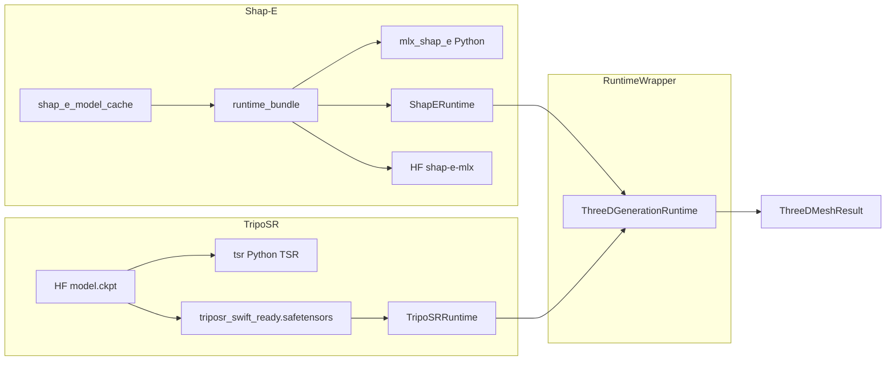
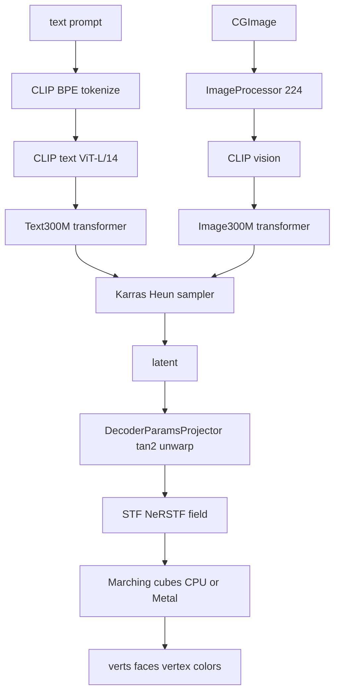
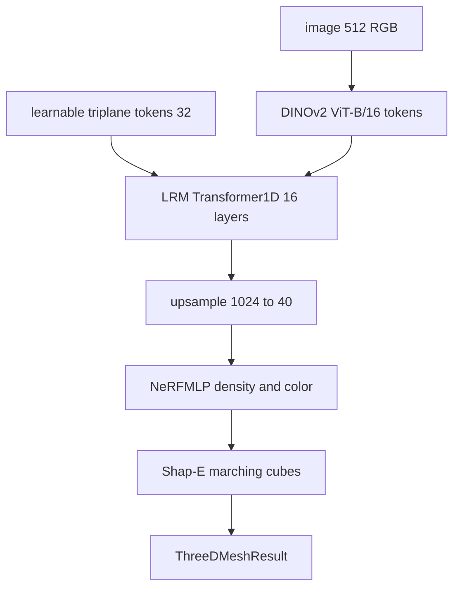

# Knowledge graph

Architectural map of this repo. The picture below is curated. Counts and [`graph.json`](graph.json) are regenerated from the tree.

<!-- knowledge-graph:generated:start -->
124 curated nodes, 193 scanned nodes, 561 edges. 193 source files have no curated node. 0 curated paths are missing on disk.
Regenerate with `python3 knowledge_graph/update_graph.py`. The pre-commit hook runs that command and stages the result.
<!-- knowledge-graph:generated:end -->

Semantic source: [`curated.json`](curated.json). Do not hand-edit `graph.json`. Node kinds are `repo`, `system`, `package`, `module`, `artifact`, `stage`, `entrypoint`, `gate`, `external`, `test`, and `note`. Edge relations are `contains`, `depends_on`, `ports`, `implements`, `produces`, `consumes`, `validates`, `calls`, `feeds`, `selects`, and `mirrors`.

This page is the picture. The JSON is the thing to grep. For the tracked,
ignored, runtime-bundle, and Hugging Face file layouts, use
[`docs/FILE-STRUCTURE.md`](../docs/FILE-STRUCTURE.md); for pinned releases,
validation scope, and publication gates, use
[`docs/RELEASE-STATUS.md`](../docs/RELEASE-STATUS.md).

## Three systems



`ShapERuntime` and `TripoSRRuntime` do not import each other. `RuntimeWrapper` is the only place they meet. An app that needs one model should import that package and skip the facade.

Swift packages:

| Package | Manifest | Products |
|---|---|---|
| ShapERuntime | `shap_e/swift/Package.swift` | library `ShapERuntime`, executable `ShapECLI` |
| TripoSR | `TripoSR/Package.swift` | library `TripoSRRuntime`, executable `TripoSRCLI` |
| TripoSR standalone | `TripoSR/swift/Package.swift` | same products, same sources |
| RuntimeWrapper | `runtime_wrapper/Package.swift` | library only |

The root TripoSR manifest exists so `RuntimeWrapper` can depend on `../TripoSR`. Sources still live under `TripoSR/swift`. All four targets are macOS 14, iOS 17, and visionOS 1, on mlx-swift 0.29.1 or newer.

Python package `mlx_shap_e` is installed from `shap_e/src` (`pyproject.toml`). Run its CLI as a module from `shap_e/src`.

## Shap-E inference



Text path exists in both Python (`MLXShapERuntime`) and Swift (`ShapERuntime`). Image path exists in Swift only, and `clip_vision` plus `image300m` load on the first image call.

Shared weight contract is `runtime_bundle/manifest.json`, artifact version 1. Families: `clip_text`, `clip_vision`, `text300m`, `image300m`, `diffusion`, `decoder_params`, `renderer`. The full audited bundle has 1,088 float32 tensors (5,141,395,248 tensor bytes); each is a headerless C-order raw `.bin` described by the manifest. The CLIP BPE vocab is not a manifest family: local exports keep it outside the bundle, while the private Hugging Face distribution places it beside `manifest.json`. Exact schema, family loaders, counts, and the Hub tree are in [`docs/FILE-STRUCTURE.md`](../docs/FILE-STRUCTURE.md#runtime-bundle-format-v1).

Python file to Swift file (`ports` edges in the JSON):

| Python | Swift |
|---|---|
| `runtime_artifacts/bundle.py`, `manifest.py` | `RuntimeArtifactBundle.swift`, `RuntimeManifest.swift`, `TensorBlobLoader.swift` |
| `models/embeddings/clip_tokenizer.py` | `ClipSimpleTokenizer.swift` |
| `models/embeddings/clip_text_embedder.py` | `ClipTextEmbedder.swift` |
| `models/text300m.py` | `Text300MTransformer.swift` |
| `models/diffusion/diffusion_step.py` | `DiffusionStep.swift` |
| `models/diffusion/karras_sampler.py` | `KarrasSampler.swift` |
| `models/decoder_params.py` | `DecoderParamsProjector.swift` |
| `models/rendering/stf_mesh_renderer.py` | `STFMeshRenderer.swift` |
| `models/rendering/marching_cubes.py` | `MarchingCubes.swift`, `MetalMarchingCubes.swift` |
| `runtime_core/pipeline.py` | `ShapERuntime.swift` |

`models/shape.py` (`ShapETransformer`) is an earlier structural sketch. The production runtime does not call it.

## TripoSR inference



`TripoSRModel.forwardTriplanes` ends at the upsampled triplanes. `evaluate` returns density and color. The arrow into marching cubes is `TripoSRMeshRuntime` inside `RuntimeWrapper`, which imports Shap-E's `MarchingCubes` and `MetalMarchingCubes`. Default grid is 256, query batch 8192, density threshold 25. Input is composited on gray. There is no background removal and no texture bake in Swift.

Python product (`TripoSR/run.py`, `gradio_app.py`) still meshes with `torchmcubes` through `MarchingCubeHelper`, and can bake a texture. Those scripts never call Swift.

Weight path, packaging only:

`stabilityai/TripoSR` `model.ckpt` → `export_tripo_weights.py` → `triposr_mlx.safetensors` → `convert_weights_to_mlx.py` → `triposr_swift_ready.safetensors`

Swift loads only the last file.

## Repository gate

`scripts/check_standards.py` enforces the mechanically decidable parts of
[`docs/CODING-STANDARDS.md`](../docs/CODING-STANDARDS.md): one primary type for
new production files, no primary-type growth in changed files, documentation
on newly added public declarations, secret/personal-path scans, oversized
files, and Markdown links. It intentionally has no file line-count rule.
`scripts/verify.sh` is the unified local entry point. Verification is
local by design because the project targets macOS, iOS, and visionOS with
MLX/Metal and local model artifacts; there is no GitHub Actions workflow.

## Parity gates

Shap-E has three layers. L2 does not replace L0 or L1. The canonical smoke case is prompt `a red chair`, seed 7, 2 steps, grid 16 (`tests/fixtures/runtime_golden_a_red_chair_steps2.json`).

| Gate | Compares | Entry |
|---|---|---|
| L0 | OpenAI torch vs Python MLX, report only | `python -m cli.check.check_*` from `shap_e/src` |
| L1 | MLX run vs a summary JSON | `python -m cli.check.check_mlx_runtime_golden` |
| L2 | Full tensors, Python MLX vs Swift | `./shap_e/scripts/run_parity.sh` |
| TripoSR | Tokens, triplanes, density, color. Correlation, not bit-exact. No mesh. | `./TripoSR/scripts/run_parity.sh` |

CPU vs Metal mesh holes: `./shap_e/scripts/run_mesh_ab.sh`. Notes in `shap_e/MESH_AB.md`.

## Recorded traps

These are `note` nodes in the graph.

- **Batch decode.** `MLXShapERuntime` accepts a batch latent. `decode_latent_to_mesh_mx` requires exactly one mesh. `run_text300m_mlx_pipeline.py` decodes `latent[0]`. Open item in `BUGS.md`.
- **Stale lazy imports.** `mlx_shap_e/__init__.py` points at `mlx_shap_e.diffusion` and `mlx_shap_e.embeddings`. Those packages are not there. The modules live under `mlx_shap_e.models`. Import the submodules.
- **TripoSR mesh docs.** `TripoSR/README.md` and `TripoSR/SCRIPTS.md` say Swift has no mesher. That is true of `TripoSRRuntime`. `RuntimeWrapper` does extract a mesh. Background removal and texture baking are still Python-only.

## Keeping it current

`update_graph.py` merges `curated.json` with a scan of Python, Swift, Metal, shell, and `Package.swift` files. A source file that already has a curated node keeps that node. Anything else becomes a `scan:` node. Import edges are added when both ends resolve to a node. A second run with no tree changes rewrites nothing.

The repo rule in `AGENTS.md` tells every agent to run the script before finishing a change. `.githooks/pre-commit` runs it again at commit time and stages `graph.json` and this file, including when the editor was not an agent. Install the hook once per clone with `knowledge_graph/install_hooks.sh`.

Edit `curated.json` when a pipeline stage, package, artifact, parity gate, or public runtime API changes. Then run the script. New files show up in `graph.json` under `meta.uncurated_files` until you give them a curated node.

## How to query

From the repo root:

```bash
python - <<'PY'
import json
from pathlib import Path
g = json.loads(Path("knowledge_graph/graph.json").read_text())
nodes = {n["id"]: n for n in g["nodes"]}
def show(id):
    n = nodes[id]
    print(f"{n['kind']:12} {n['name']}")
    print(n["summary"])
    for e in g["edges"]:
        if e["from"] == id:
            print(f"  -{e['rel']:12}-> {e['to']}  {nodes[e['to']]['name']}")
        elif e["to"] == id:
            print(f"  <-{e['rel']:12}- {e['from']}  {nodes[e['from']]['name']}")
show("mod.swift.runtime")
PY
```

Replace the id to walk a different node. Stage ids are `stage.se.*` and `stage.ts.*`. Port edges are `rel == "ports"`.
